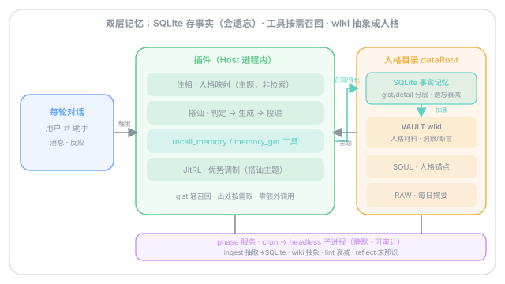

## What it is

A reusable **persona-memory engine**: the mechanism ships in the package, while memory lives only in your persona directory (`dataRoot`) — the package contains no memory. Install it to get the engine, then fill in your persona.

## Two-tier memory (v1.2.0)

Memory has two layers with a one-way flow — **SQLite is the memory authority; the wiki is persona material abstracted from it**:

| Layer | Medium | Stores | Traits |
|---|---|---|---|
| **Fact memory** | SQLite (built-in `node:sqlite`, zero deps) | facts / preferences / episodes / corrections | precise, invalidatable, provenance, **forgetting decay**, gist/detail split |
| **Persona material** | vault markdown (wiki) | insights / claims / genes | **abstracted** from memory; feeds persona growth / snapshot / manas |

- **On-demand tool recall**: `recall_memory(query)` returns relevant facts (compact cards); `memory_get(id)` fetches a quote and source. **Independent of the snapshot** — the snapshot is a persona projection, not memory retrieval. Aligned with Letta / OpenClaw / Claude tool retrieval; cross-session and long-term.
- **Layered storage saves tokens**: `memory_gist` (light: triple + strength) and `memory_detail` (heavy: quote + provenance) are physically split; recall returns gists + entity grouping, provenance fetched on demand (~5× token saving). Temperature tiers: active + pinned by default, sunken memory only with `deep`.
- **Forgetting**: retrievability `R = importance × exp(-Δt/half-life)` fades with disuse; recall reinforces it. Identity-level facts can be pinned. **Forgetting only lowers recall weight — records and provenance are never physically deleted.**
- **Provenance chain**: conversation → memory ID → wiki claim, fully traceable.
- **Anti-fabrication**: every memory requires a verbatim quote and source; no quote, no entry. Low-confidence memories get low importance and decay away.
- **Modular & extensible**: versioned schema migrations, a pluggable Retriever interface (lexical → semantic/hybrid reserved), and pure-function memory dynamics.

## Subsystems

| Subsystem | Role | Default |
|---|---|---|
| **Wiki four phases** | ingest daily summary → wiki weekly distill → lint weekly aging → reflect manas every 5 days | on |
| **Proactive outreach** | speaks up when silent long enough and the session is idle (energy / time-slot / motive) | on |
| **Per-turn snapshot** | injects a first-person "view of this moment" into the system prompt each turn | on |
| **JitRL** | learns selection preferences from replies / verified memory (no training, zero extra calls) | on |

The four phases run in a headless subprocess via the plugin's own scheduler: no session, no approval prompt, auditable failures.

## Privacy & boundaries

- Memory and persona live **only in `dataRoot`**; the package holds none.
- Fact-memory switch `factMemory.enabled` (default on) auto-creates the DB on mount; off means SQLite is never touched.
- Recall and abstraction are qualitative mechanisms; internal experiment data is not distributed with the repo.