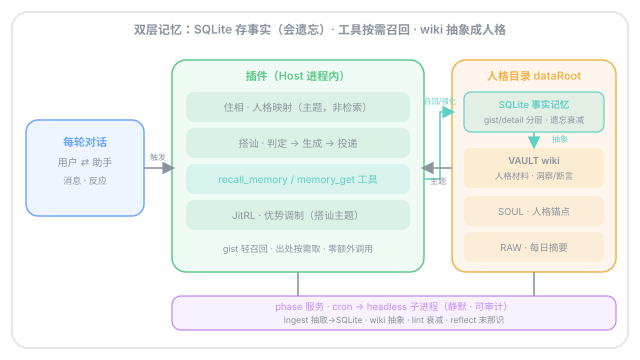

## 这是什么

一套可复用的**人格记忆引擎**：机制在插件包里，记忆只写在你指定的人格目录（`dataRoot`），包里不含任何记忆。装上即有记忆引擎，再按你的设定填上人格。

## 双层记忆（v1.2.0）

记忆分两层，单向流动——**SQLite 是记忆的权威，wiki 是它抽象出的人格材料**：

| 层 | 载体 | 存什么 | 特性 |
|---|---|---|---|
| **事实记忆** | SQLite（`node:sqlite` 内置，零依赖） | 事实 / 偏好 / 事件 / 纠正 | 精确存储、可作废、带出处、**遗忘衰减**、gist/detail 分层 |
| **人格材料** | vault markdown（wiki） | 洞察 / 断言 / 基因 | 从记忆**抽象**而来，供人格进化 / 住相 / 末那识 |

- **工具式按需召回**：`recall_memory(query)` 召回相关事实（精简事实卡），`memory_get(id)` 取原话与出处。**独立于住相**——住相是人格映射，不做记忆检索。对齐 Letta / OpenClaw / Claude 的工具检索范式，跨会话长期。
- **分层存储省 token**：`memory_gist`（轻：三元组+强度）与 `memory_detail`（重：原话+出处）物理分层；召回只回 gist + 同主语实体聚合，出处按需取，约 5× token 节省。温度分层：默认查活跃+钉住，沉底记忆 `deep` 才查。
- **遗忘机制**：可召回度 `R = 重要度 × exp(-Δt/半衰期)`，越久不用越淡；被召回则强化。身份级事实可钉住免衰减。**遗忘只降召回权重，记录与出处永不物理删除。**
- **出处链**：对话 → 记忆 ID → wiki 断言，全程可追溯。
- **防编造**：每条记忆强制带原话与出处，抽不出原话不入库；低置信记忆重要度低、衰减快，自然淘汰。
- **模块化可扩展**：schema 版本化迁移、Retriever 检索接口可插拔（字面→语义/混合预留）、动力学纯函数独立。

## 子系统

| 子系统 | 作用 | 默认 |
|---|---|---|
| **Wiki 四相** | ingest 每日摘要 → wiki 每周提炼 → lint 每周老化 → reflect 每 5 天末那识 | 开 |
| **主动搭讪** | 沉默够久、会话空闲时主动开口（能量 / 时段 / 动机判定） | 开 |
| **每轮住相** | 每轮注入一段第一人称「此刻的视角」到 system prompt | 开 |
| **JitRL** | 用「回没回」「记忆是否被证实」学习选择偏好（不训练、零额外调用） | 开 |

四个 phase 由插件自带调度器跑在 headless 子进程：不开会话、不弹审批、失败可审计。

## 隐私与边界

- 记忆与人格**只在 `dataRoot`**，插件包里没有任何记忆。
- 事实记忆开关 `factMemory.enabled`（默认开），挂载时自动建库；关闭则完全不碰 SQLite。
- 召回与抽象均为定性机制；内部实验数据不随仓库分发。